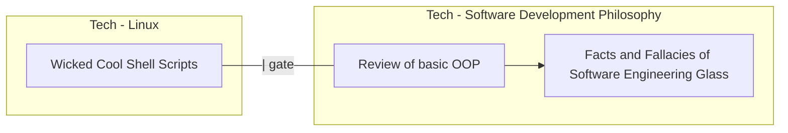
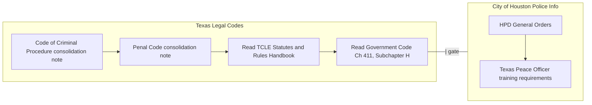

# Tech



```dataview
TABLE isActive AS "Active?", focusedSource AS "In-Focus Resource", AP
FROM #Plate/Tech
SORT isActive DESC
```

---
# [[What to do and How to be]]



```dataview
TABLE isActive AS "Active?", focusedSource AS "In-Focus Resource", AP
FROM #Plate/WhatToDo
SORT isActive DESC
```

# this
```dataview
TABLE isActive AS "Active?", focusedSource AS "In-Focus Resource", AP
FROM #Plate/this
SORT isActive DESC
```

---

# Log:
2026-10-25:
Done:
 - added diagrams to Tech and What To Do Plate tables above, to give an idea of what we are currently working on and what is next
To Do
 - Finish rewording sources tags to "resource"
 - define AP for all active Plates
     - also determine what the next Plate should be for each AP
 - define AP for all in-focus resources

2026-09-07:
**Note:**
We're not waking up early consistently enough to assign a Plate to the before-work part of the day. So we should **attend to** the active Plates **sequentially**; each one gating the next. 
Also, we must explicitly assign AP to each active Plate. **AP gates** subsequent Plates.
Also, we must define better/clearer transitions. The idea of **grouping Plates** occurred to us today, the idea being that we **rotate sequentially** through a given Plate group using AP as the transition indicator. 
One detail that has emerged is the it is hard to keep up with more that 3 active Plates at a time. Maybe even 3 is too many. Let us then **cap** the number of **active Plates at 3**. This means we can only be working through 3 Plate groups at a time. There can be more than 3 groups, of Plates, but some of those groups will be idle. This is fine. Time and attention are finite. 
**Done:**
Based on the preceding notes, we have grouped Plates into the following 3 categories: 
 - Tech
 - What To Do
 - this (personal/self-improvement stuff)
Also, we added **AP** and **isActive** properties to each Plate.
Also, we updated the active (previously "Priority A") Plates to list their sources in tables instead of simple lists. 
Also, to the individual sources of these ^ same Plates we added **isInFocus** and **AP** properties.
Also, we began rewording Plate "sources" to "resources".
The point of all this ^ is to make it clear at a glace
 - which Plates are active
 - which resources as in-focus in those active Plates
 - what is the AP for an in-focus resource
 - what is the next resource
 - what is the AP for an active Plate
 - what is the next Plate
Also, we moved [[QUESTIONS]] and [[ESSAYS]] out of Dataviews and into the **this** Plate
**To do:**
 - Finish rewording sources tags to "resource"
 - define AP for all active Plates
     - also determine what the next Plate should be for each AP
 - define AP for all in-focus resources
