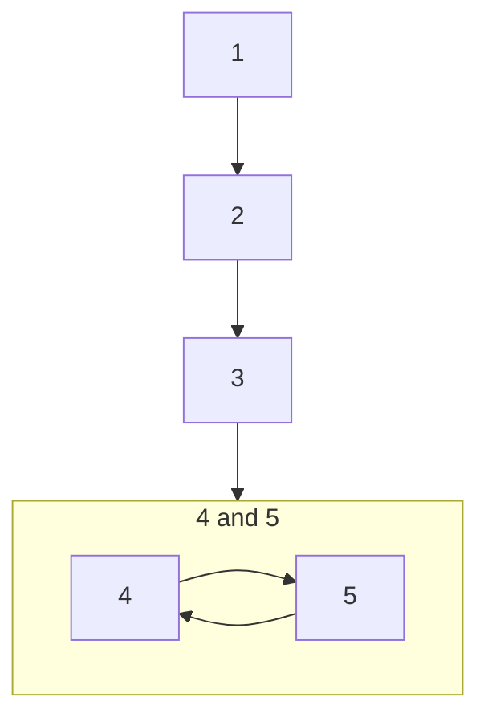

---
tags:
  - Note/Plate/Tech/Resource/SoftwareDevelopmentPhilosophy
plate: Tech
progressionPosition: "3"
isInFocus: Y
AP: 
createdDate: 2026-06-12
---
# Description

**2026-10-25**
We could not find either of the Deitel textbooks (Java, C++), so we decided to just review whatever OOP summaries are available online. 
 1.  https://www.geeksforgeeks.org/dsa/introduction-of-object-oriented-programming/
 2. https://www.designgurus.io/blog/object-oriented-programming-oop 

In addition to this ^ we picked up the following OOP resources: 
 3.  [[UML Distilled 3rd Edition - Fowler]]
 4. [[Applying UML and Patterns - Larman]]
 5. [[Design Patterns]]

We should proceed thru these resources like so: 

**6/23/2026:** This is a general subject, not a specific source. We have a basic programming book somewhere in our boxes, we should dig it out and study that. Otherwise there are innumerable free resources on this subject online.  

**Scope**:
**AP**:  
**ap**:  
