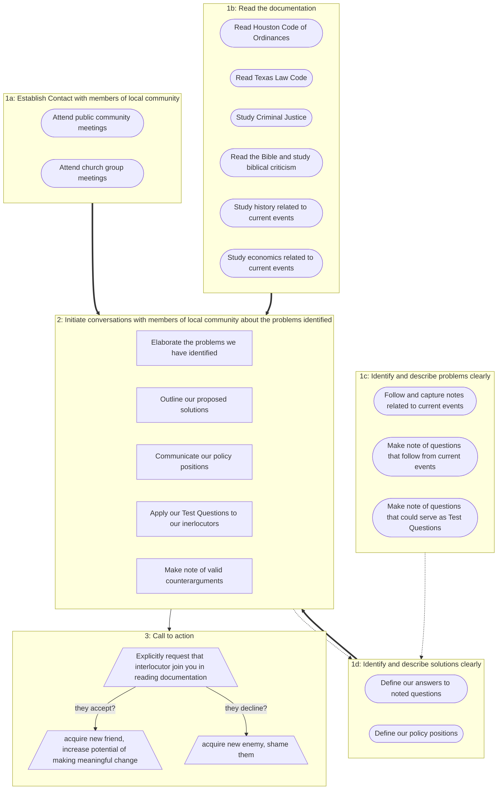

# The Point:
I have an overwhelming feeling that something is deeply, fundamentally wrong with the way the society in which I live operates. 
I look around at how my fellow citizens in my neighborhood and in my state and in my country behave, and I compare this behavior to the story I've been told since childhood about this country and its culture, and the gap cannot be ignored. See [[What To Do]].
But my reaction to this gap is almost entirely emotional, because I lack sufficient knowledge about the details of how the system is supposed to work. I cannot clearly articulate my frustrations, nor am I able to propose meaningful, actionable alternatives. I'm just angry.
Hence this work.

The point of this work is to answer the questions
    "What do you do when the government enacts policies that you disagree with?
    What does it mean for a citizen to participate in between elections?"
Everything below is towards answering these questions.
When the answering is sufficiently done, then the doing must begin. 

# What we are doing:
The following graph illustrates the work we are doing towards answering the above questions.
Summary: 
 1. Concurrently:
     -  **a**: establish contact with people in my local community 
     -  **b**: study subjects we consider relevant for providing necessary context for  
     -  **c**: identify and characterize the problems we perceive
     -  **d**: identify and describe clear solutions to these ^ problems, organize our thoughts in order to clearly state and defend our positions
 2. initiate difficult "What to do?" conversations with those in my community about the state of political affairs at all levels of government 
 3. call people to action, induce them to participate to a more meaningful extent, shame them if they refuse



# Relevant Plates:
The following Plates represent subjects and tasks that correspond to graph nodes **1b**, **1c**, and **1d** above.

```dataview
TABLE isActive AS "Active?", focusedSource AS "In-Focus Resource", AP
FROM #Plate/WhatToDo
SORT isActive DESC
```


# Relevant Notes: 
```dataview
LIST
FROM #Note/WhatToDo or #Note/HowToBe 
SORT createdDate DESCENDING 
```

---
# Log
2026-11-15
Done:
 - We refined and expanded this organizational note:
     -  expanded and elaborated on the **The Point** section
     -  added descriptions/summaries to the **What we are doing** and **Relevant Plates** sections
     -  added [[Bible and Religion]] Plate
     -  added resources to [[History]] Plate (McCollough and Ellis)
To Do
 - begin working on [[QUESTIONS]] and [[Test Questions]]
 - write the [[Blindsight + On Bullshit]] summary 
 - read the Bible & biblical criticism


2026-10-04
This work is currently only organized in my head. We need to outline a progression, and maybe make a better diagram. 
For now the things I know we need to do are: 
 - finish reading [[Texas Legal Codes]] 
 - read HPD General Orders in [[City of Houston Police info]]
 - 

The [[QUESTIONS]] and [[Test Questions]] are what we need in order to start talking to folks.
The [[Blindsight + On Bullshit]] summary is to give us a framework for cutting through bullshit.

2026-09-17
Began bringing some order to this note. Added the "The Point:" section, which we will be modifying and clarifying going forward. But as it stands is pretty well captures the work. Also added the "Relevant Plates" section. 

2026-09-12
Added the "Illustrative Flowchart" to put the work we are doing into context, or to connect all of the work we're doing and to highlight the connections. 